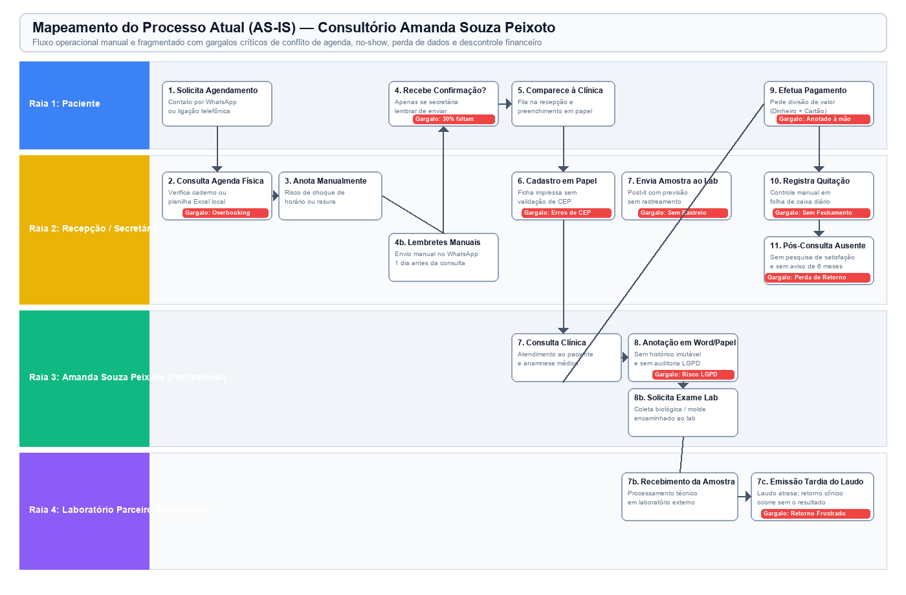
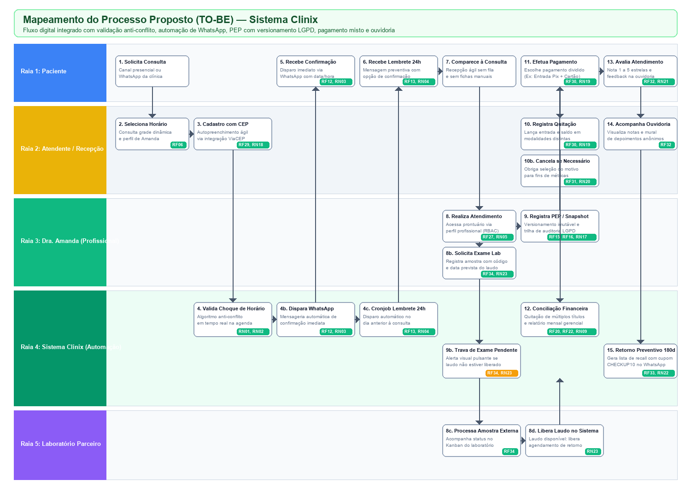

# Análise de Negócio
## Necessidades e Proposta de Solução — Sistema Clinix

---

### **Instituição de Ensino Superior:**
**CEUB — Centro Universitário de Brasília**  
**Curso:** Bacharelado em Engenharia de Software  
**Disciplina:** Engenharia de Requisitos  
**Docente:** Prof. Sérgio Haddad  

---

### **Equipe de Desenvolvimento:**
- **Davi Felinto**
- **Isaac Soares**
- **Miguel Dias**
- **Lucas Evaldo**
- **Vanessa Mendoça**

**Local e Data:** Brasília – DF, Outubro de 2026  

---

### **Controle de Versões**

| Data | Versão | Descrição | Autor(es) |
| :---: | :---: | :--- | :--- |
| **20/10/2026** | **1.0** | Versão Inicial da Análise de Negócio do Sistema Clinix (Entrevista com a cliente Amanda Souza Peixoto, Mapeamentos BPMN AS-IS e TO-BE, Problemas, Objetivos, Funcionalidades e Requisitos). | Davi Felinto, Isaac Soares, Miguel Dias, Lucas Evaldo, Vanessa Mendoça |

---

## 1. Análise Institucional e Funcional

### 1.1 Contexto e Perfil da Organização Demandante
A solução destina-se a consultórios e clínicas ambulatoriais de pequeno porte dedicados ao atendimento em saúde humana (especialidades médicas, odontológicas, psicologia clínica, fisioterapia, nutrição e terapias integradas).

A cliente entrevistada e patrocinadora deste estudo de caso é **Amanda Souza Peixoto**, profissional de saúde e gestora de consultório clínico ambulatorial situado em **Brasília – DF**. A clínica oferece consultas presenciais eletivas, procedimentos diagnósticos e terapêuticos de rotina, além de realizar encaminhamento de amostras biológicas e materiais clínicos para laboratórios especializados terceirizados.

### 1.2 Áreas de Negócio Relacionadas
O negócio estrutura-se em cinco áreas operacionais interdependentes:
1. **Recepção e Atendimento Inicial:** Ponto focal de triagem, identificação cadastral, agendamento de consultas presenciais/remotas, confirmação de horários e acolhimento dos pacientes.
2. **Atendimento Clínico Especializado:** Execução da consulta médica/terapêutica, anamnese, registro de hipóteses diagnósticas, prescrições, evolução em prontuário e solicitação de exames complementares.
3. **Gestão Financeira e Faturamento:** Emissão de cobranças vinculadas às consultas, quitação em modalidades à vista e parceladas (dinheiro, PIX, cartão de crédito/débito, convênio), conciliação de pagamentos mistos (entrada + saldo) e controle de fechamento mensal.
4. **Relacionamento, Fidelização e Ouvidoria:** Gestão de satisfação do paciente, canal de ouvidoria para manifestações espontâneas (elogios, críticas, sugestões) e rotinas de recall ativo para retornos preventivos periódicos.
5. **Apoio Diagnóstico (Laboratorial Externo):** Gestão de coletas realizadas no consultório e acompanhamento da esteira de transporte, análise e liberação de laudos emitidos por centros parceiros terceirizados.

### 1.3 Mapeamento de Stakeholders

| Stakeholder | Papel no Negócio | Interesses e Necessidades Principais |
| :--- | :--- | :--- |
| **Amanda Souza Peixoto** | Profissional de Saúde / Gestora / Patrocinadora | Eliminar conflitos na agenda, dispor de prontuário eletrônico ágil e juridicamente seguro (LGPD), rastrear motivos de cancelamento e ter controle do faturamento mensal. |
| **Secretárias / Recepcionistas** | Operação da Recepção e Atendimento | Agilidade no preenchimento de cadastros (busca de CEP), facilidade na marcação de consultas sem risco de rasura e flexibilidade para receber pagamentos divididos. |
| **Pacientes (Clientes Finais)** | Usuários dos Serviços de Saúde | Facilidade de agendamento, pontualidade no atendimento (sem atrasos por overbooking), recebimento de lembretes preventivos via WhatsApp e privacidade de seus dados clínicos. |
| **Laboratórios Parceiros Terceirizados** | Prestadores de Serviços Diagnósticos | Recebimento de dados padronizados das amostras, cumprimento de prazos de laudos e sincronia com a agenda médica para evitar retornos prematuros. |
| **Prof. Sérgio Haddad (Docente CEUB)** | Orientador Acadêmico e Avaliador | Avaliação do rigor metodológico de Engenharia de Requisitos, mapeamento de processos BPMN e conformidade com o modelo formal de entrega. |
| **Órgãos Reguladores (Conselhos de Classe, ANVISA e ANPD)** | Fiscalização Ética e Legal | Conformidade com as resoluções profissionais sobre prontuário eletrônico (CFM nº 1.821/2007) e proteção de dados sensíveis (Lei 13.709/2018 - LGPD). |

*(Nota: O mapeamento detalhado dos processos de negócio AS-IS e TO-BE encontra-se referenciado na Seção 2, Seção 4.1 e anexado integralmente no Anexo 5.1 deste documento).*

---

## 2. Mapeamento do Processo Atual (AS IS)

### 2.1 Descrição Operacional do Processo Atual
Atualmente, as rotinas operacionais no consultório de **Amanda Souza Peixoto** são conduzidas de forma descentralizada, artesanal e com forte dependência de registros manuais em papel, planilhas avulsas do Microsoft Excel e trocas de mensagens individuais no aplicativo WhatsApp pessoal/comercial:

1. **Solicitação e Marcação de Horários:** O paciente entra em contato telefônico ou envia mensagem de texto no WhatsApp solicitando uma consulta. A secretária consulta manualmente uma agenda física de papel ou uma planilha do Excel. Devido a anotações apressadas, rasuras e múltiplos atendimentos simultâneos no balcão, ocorrem frequentes sobreposições de horários (duas pessoas marcadas no mesmo intervalo), além de horários vagos que passam despercebidos.
2. **Confirmação e Lembretes:** A confirmação das consultas depende exclusivamente da secretária digitar e enviar mensagens manuais de WhatsApp um dia antes do atendimento. Quando a recepção fica sobrecarregada com pacientes presenciais ou atendimento telefônico, essa tarefa é omitida, resultando em uma taxa média de absenteísmo (**no-show**) de **25% a 30%** dos agendamentos diários.
3. **Chegada e Cadastro do Paciente:** Ao comparecer ao consultório, o paciente recebe uma prancheta com ficha de papel para preenchimento manuscrito de seus dados pessoais (nome, CPF, data de nascimento, endereço e alergias). Como não há conferência automática de CEP, endereços são frequentemente anotados de forma incompleta, inviabilizando contratos formais ou notificações de cobrança.
4. **Atendimento Clínico e Registro do Prontuário:** Amanda atende o paciente e faz anotações em fichas de papel ou cria arquivos avulsos no Microsoft Word armazenados no disco rígido do computador da clínica. Esse método acarreta três graves fragilidades:
   - *Ausência de versionamento imutável:* Se uma anotação for editada semanas depois, o texto anterior é sobrescrito sem deixar rastro do original ou da justificativa;
   - *Risco de perda e extravio:* Vulnerabilidade a falhas de hardware, exclusão acidental ou perda física de fichas;
   - *Não conformidade com a LGPD:* Falta de trilha de auditoria (logs de acesso), violando o sigilo de dados sensíveis de saúde exigido pelos Artigos 7º e 11º da Lei nº 13.709/2018.
5. **Solicitação e Rastreamento de Exames Laboratoriais:** Quando o procedimento requer coleta de biópsia, sangue ou moldagens protéticas, o material é encaminhado para um laboratório parceiro com uma guia manual. A previsão de liberação do laudo é anotada em um bloco de notas adesivas (post-it). Sem um controle centralizado, o paciente muitas vezes comparece à consulta de retorno sem que o laudo tenha sido liberado, frustrando o atendimento e forçando a remarcação.
6. **Cobrança e Quitação de Procedimentos:** Na saída do consultório, a secretária cobra o valor estipulado. Em procedimentos de maior valor, o paciente frequentemente solicita pagar uma entrada em dinheiro/PIX e o saldo restante no cartão de crédito em parcelas. A planilha atual não suporta múltiplos pagamentos para um mesmo atendimento, forçando anotações manuais que geram divergências de caixa e inadimplência oculta no fechamento mensal.
7. **Pós-Consulta e Retenção:** Não existe pesquisa de satisfação estruturada. Amanda desconhece o nível de satisfação dos pacientes em relação ao atendimento da recepção e à limpeza das instalações. Além disso, pacientes que deveriam retornar após seis meses para manutenção preventiva são esquecidos, ocasionando evasão de clientes e perda de receita recorrente.

### 2.2 Diagrama BPMN do Processo Atual (AS-IS)
O mapeamento em raias (*swimlanes*) a seguir sintetiza os pontos de contato, atividades e gargalos críticos do processo manual atual:

```
[ Diagrama BPMN AS-IS: Consulte a representação visual em imagem no Anexo 5.1 ]
```
*(As quatro raias compreendem: Raia 1: Paciente | Raia 2: Recepção/Secretária | Raia 3: Amanda Souza Peixoto | Raia 4: Laboratório Parceiro Terceirizado).*

---

## 3. Identificação do(s) Problema(s) ou Necessidade(s)

Com base nas entrevistas e reuniões de levantamento realizadas diretamente com a cliente **Amanda Souza Peixoto**, foram identificadas oito necessidades e problemas de negócio prioritários:

1. **Problema 1 — Conflitos de Agenda e Choque de Horários (Overbooking):**
   - *Descrição:* A marcação manual em agendas de papel e planilhas estáticas não possui mecanismos de bloqueio algorítmico, resultando em pacientes aguardando simultaneamente na recepção e gerando desgaste profissional.
   - *Necessidade:* Mecanismo inteligente com validação matemática instantânea de disponibilidade de horários.
2. **Problema 2 — Elevada Taxa de Absenteísmo (No-Show de 25% a 30%):**
   - *Descrição:* Pacientes esquecem suas consultas agendadas com dias ou semanas de antecedência, pois os lembretes manuais não são enviados com regularidade.
   - *Necessidade:* Disparo automático e padronizado de mensagens de confirmação imediata e lembretes com antecedência de 24 horas via mensageria digital (WhatsApp).
3. **Problema 3 — Insegurança Jurídica, Fragilidade e Risco de Violação da LGPD nos Prontuários:**
   - *Descrição:* O uso de papéis e arquivos Word desprotegidos expõe dados sensíveis de saúde a terceiros, sem garantia de integridade, sem snapshots de versões anteriores e sem trilha de auditoria com IP, data e operador.
   - *Necessidade:* Prontuário Eletrônico do Paciente (PEP) integrado com criptografia, controle estrito de perfis de acesso (RBAC), histórico imutável de alterações e conformidade integral com a Lei 13.709/2018 (LGPD).
4. **Problema 4 — Dificuldade na Gestão Financeira de Pagamentos Mistos / Divididos:**
   - *Descrição:* Pacientes necessitam parcelar procedimentos dividindo a quitação em modalidades distintas (ex.: Entrada no PIX/Dinheiro e Saldo no Cartão em parcelas). As ferramentas atuais forçam o registro em um único método ou em papéis avulsos, impossibilitando a conciliação bancária correta.
   - *Necessidade:* Suporte nativo ao desdobramento de cobranças em Entrada + Saldo com cálculo automático de quitação e relatórios mensais.
5. **Problema 5 — Desconhecimento dos Motivos Reais de Cancelamento de Consultas:**
   - *Descrição:* Cancelamentos são apenas apagados da agenda. Amanda não sabe se as desmarcações ocorrem por motivo financeiro, incompatibilidade de agenda, insatisfação ou problemas de saúde.
   - *Necessidade:* Registro categorizado e obrigatório dos motivos de cancelamento com geração de indicadores gerenciais de atrito e evasão (*churn clínico*).
6. **Problema 6 — Ausência de Mecanismo de Ouvidoria e Avaliação de Satisfação:**
   - *Descrição:* A gestão não dispõe de dados para avaliar a percepção dos pacientes quanto à pontualidade, simpatia da recepção, qualidade clínica e higiene do espaço físico.
   - *Necessidade:* Canal estruturado de ouvidoria com avaliação rápida de 1 a 5 estrelas e comentários opcionais sob anonimato garantido.
7. **Problema 7 — Perda de Receita Recorrente por Descontinuidade de Retornos Preventivos (180+ Dias):**
   - *Descrição:* Pacientes submetidos a procedimentos eletivos deixam de realizar a manutenção preventiva semestral por falta de lembrete da clínica, reduzindo a receita previsível do negócio.
   - *Necessidade:* Identificação proativa de pacientes com última consulta há mais de 180 dias e acionamento em 1 clique para envio de convite preventivo com cupom de fidelidade de 10% (`CHECKUP10`).
8. **Problema 8 — Retornos Clínicos Frustrados por Amostras Laboratoriais Sem Laudo Liberado:**
   - *Descrição:* A clínica não acompanha o ciclo de vida de exames enviados a laboratórios externos, marcando consultas de retorno antes da chegada do resultado.
   - *Necessidade:* Painel de rastreamento do ciclo de vida das amostras (Coletado, Enviado, Em Análise, Laudo Disponível, Entregue) com alerta visual pulsante e impeditivo na agenda.

---

## 4. Proposta de Solução

### 4.1 Visão Geral da Solução Proposta
Propõe-se o desenvolvimento e implantação do **Clinix — Sistema de Agendamento e Prontuário para Clínicas Pequenas**, uma plataforma computacional moderna, segura e responsiva, projetada sob a arquitetura de **Micro-serviços/Camadas Desacopladas (Clean Architecture)** com backend em **C# (.NET 8)**, persistência relacional **MySQL 8.0/8.4** e interface web intuitiva consumível via navegadores desktop e dispositivos móveis (smartphones e tablets).

A solução digitaliza de ponta a ponta a cadeia de valor da clínica de Amanda Souza Peixoto, integrando a recepção, o consultório médico, a gestão financeira e os laboratórios parceiros em um único ambiente integrado.

### 4.2 Mapeamento do Processo Proposto (TO BE)
O novo processo de negócio elimina tarefas manuais repetitivas, insere validações algorítmicas de integridade e promove a comunicação digital automatizada:

1. **Agendamento Assistido e Validação Anti-Conflito:** Ao receber a solicitação, a atendente seleciona o profissional e o horário na grade dinâmica do Clinix. O sistema executa instantaneamente a validação matemática de intervalo (`inicio < fim_agendado && fim > inicio_agendado`), bloqueando choques de horário em milissegundos (**RN01, RN02**).
2. **Autopreenchimento Cadastral com CEP:** No cadastro de novos pacientes, a digitação dos 8 dígitos do CEP aciona a integração com o serviço ViaCEP via proxy backend, preenchendo automaticamente rua, bairro, cidade e estado (**RF29, RN18**).
3. **Engajamento e Redução de No-Show via WhatsApp:** Imediatamente após a gravação da consulta, o sistema dispara a notificação de confirmação via WhatsApp (**RF12, RN03**). Exatamente 24 horas antes do atendimento, um serviço de segundo plano dispara o lembrete preventivo (**RF13, RN04**).
4. **Atendimento Clínico com PEP Imutável e Auditoria LGPD:** Amanda acessa o sistema com credenciais autenticadas via JWT e perfil Profissional (**RF26, RF27**). Toda evolução clínica é registrada no Prontuário Eletrônico do Paciente. Caso uma anotação precise ser corrigida, o sistema cria um *snapshot* imutável da versão anterior com data, autor e justificativa (**RF16, RN17**), gerando log em tabela somente-leitura (**RF28, RN13**).
5. **Rastreamento de Exames Laboratoriais Externos:** Se houver coleta de amostra biológica ou molde, a profissional registra o pedido laboratorial informando laboratório parceiro, código de rastreio e data prevista do laudo (**RF34**). Na agenda, a consulta exibe um badge visual pulsante até a liberação do laudo (**RN23**), impedindo retornos prematuros.
6. **Pagamento Misto / Dividido e Fechamento Financeiro:** O faturamento permite selecionar a opção "Dividir Pagamento". A secretária registra a Entrada (ex.: PIX) e programa o Saldo restante (ex.: Cartão de Crédito) com validação de soma total (**RF30, RN19**). O relatório mensal consolida as receitas por competência e caixa (**RF22, RN09**).
7. **Ouvidoria e CRM de Retorno Preventivo:** O paciente avalia o atendimento através de notas de 1 a 5 estrelas e depoimento na Ouvidoria (**RF32, RN21**). O dashboard identifica automaticamente pacientes sem atendimento há mais de 180 dias, permitindo enviar convites com cupom de 10% de fidelidade (`CHECKUP10`) em 1 clique (**RF33, RN22**).

*(Consulte o diagrama visual completo do processo TO-BE no Anexo 5.1 deste documento).*

---

### 4.3 Objetivos da Solução

#### Objetivo Geral:
Desenvolver, homologar e implantar um sistema computacional integrado de gestão de agendamentos, prontuário eletrônico seguro em conformidade com a LGPD e administração financeira/ouvidoria para consultórios e clínicas de pequeno porte.

#### Objetivos Específicos:
1. **Erradicar 100% dos conflitos de agenda** através de motor de validação algorítmica de sobreposição temporal antes da confirmação de agendamentos e bloqueios (**RN01, RN02, RN14**).
2. **Reduzir a taxa de absenteísmo (no-show) de 30% para menos de 5%** por meio de automação de confirmações imediatas e lembretes preventivos de 24 horas via mensageria digital WhatsApp (**RF12, RF13, RN03, RN04**).
3. **Garantir a conformidade legal e segurança jurídica dos prontuários (LGPD e CFM)**, implementando histórico de versões imutáveis para alterações clínicas e trilha de auditoria completa em tabela *append-only* (**RF15, RF16, RF28, RN13, RN17, RQ03, RQ07**).
4. **Agilizar o tempo de cadastro em até 60%**, integrando autopreenchimento de dados de endereço a partir da consulta síncrona de CEP (**RF29, RN18**).
5. **Prover conciliação financeira precisa para pagamentos divididos**, permitindo o desdobramento da quitação em entrada e saldo restante em modalidades de pagamento distintas (**RF30, RN19**).
6. **Diagnosticar causas de perda de pacientes**, tornando obrigatório o registro da categoria e justificativa em cancelamentos de consultas (**RF31, RN20**).
7. **Instituir mecanismo contínuo de ouvidoria clínica e métricas de satisfação (NPS)**, coletando avaliações estruturadas de 1 a 5 estrelas para recepção, atendimento clínico e instalações (**RF32, RN21**).
8. **Alavancar a receita recorrente em até 20%**, monitorando ativamente pacientes sem retorno há mais de 180 dias com campanhas de fidelidade semi-automatizadas (**RF33, RN22**).
9. **Eliminar retornos clínicos improdutivos**, rastreando o ciclo de vida de amostras laboratoriais externas com alertas visuais integrados à grade de agendamento (**RF34, RN23**).

---

### 4.4 Benefícios da Solução

| Dimensão | Benefício Concreto | Métrica / Impacto Esperado |
| :--- | :--- | :--- |
| **Operacional** | Eliminação completa de duplicidades e choques de horários | 100% de precisão na alocação de tempo clínico |
| **Econômico** | Redução drástica das faltas injustificadas (*no-show*) | Recuperação de até 25% a 30% da receita diária ociosa |
| **Produtividade** | Cadastro ágil de pacientes com preenchimento automático por CEP | Redução de 3 minutos para menos de 45 segundos por ficha |
| **Jurídico / Ético** | Conformidade rigorosa com a LGPD (Lei 13.709/2018) e CFM | Mitigação de multas da ANPD e segurança contra contestações |
| **Financeiro** | Flexibilização de vendas através de pagamento misto (Entrada + Saldo) | Aumento da taxa de conversão de procedimentos de alto valor |
| **Estratégico** | Visibilidade analítica das razões de cancelamento e evasão | Dados para ações corretivas de gestão e precificação |
| **Qualidade / CRM** | Canal estruturado de ouvidoria e notas de 1 a 5 estrelas | Melhoria contínua da experiência do paciente no consultório |
| **Recorrência** | Retomada ativa de pacientes preventivos há 180+ dias sem contato | Previsibilidade de faturamento com cupom de fidelidade |
| **Clínico** | Rastreabilidade de laudos laboratoriais e alertas na agenda | Zero retrabalho de consultas sem resultado de exame em mãos |

---

### 4.5 Características da Solução
A plataforma Clinix foi concebida com características arquiteturais e funcionais focadas na experiência do usuário e na robustez operacional:

- **Acessibilidade Multiplataforma via Web:** Acesso universal por meio de qualquer navegador moderno (Chrome, Edge, Firefox, Safari) em notebooks, desktops e tablets sem necessidade de instalações locais complexas.
- **Operação Rápida e Usabilidade Otimizada (Regra dos 3 Cliques - RQ10):** Menus e fluxos desenhados para que qualquer operação essencial (marcar consulta, abrir prontuário ou registrar pagamento) seja concluída em no máximo 3 cliques a partir da tela inicial.
- **Arquitetura em Camadas com Inversão de Dependência:** Isolamento estrito entre a interface visual (HTML5, TailwindCSS, React), a lógica de negócio (C# .NET 8) e o banco de dados (MySQL 8.0/8.4 via Dapper).
- **Segurança da Informação e Criptografia Forte (RQ08):** Armazenamento de senhas com algoritmo PBKDF2/SHA-256 e Salt criptográfico de alta entropia; autenticação baseada em tokens JWT e proteção contra ataques de força bruta (*Rate Limiting*).
- **Controle de Acesso Baseado em Perfis (RBAC - RF27):** Diferenciação de privilégios entre Administradores/Recepcionistas (acesso a agenda, cadastros e faturamento) e Profissionais de Saúde (acesso privativo a prontuários e hipóteses diagnósticas).
- **Persistência Relacional em 3ª Forma Normal (3FN):** Esquema relacional íntegro garantido por chaves estrangeiras, restrições de integridade e índices de busca rápida.
- **Tolerância a Falhas e Resiliência Híbrida (RQ15):** Mecanismo de persistência defensiva com sincronização local em `localStorage` para continuidade operacional em caso de instabilidade transitória de rede.

---

### 4.6 Funcionalidades e Principais Requisitos Funcionais

A solução estrutura-se em onze macrofuncionalidades que atendem integralmente aos requisitos elicitados:

#### Funcionalidade 1 — Autenticação Segura e Controle de Perfis (RBAC)
- **Descrição:** Login seguro de usuários (Profissionais de Saúde e Administradores/Recepcionistas) com credenciais criptografadas e sessão controlada por token JWT.
- **Conjunto de Dados:** Login (e-mail institucional), senha criptografada (hash + salt), nome completo, perfil de acesso (Profissional ou Administrador), timestamp de último acesso.
- **Regras de Negócio e Requisitos:** Atende a **RF26, RF27, RN11, RN12, RQ06, RQ08**.

#### Funcionalidade 2 — Cadastro de Pacientes com CEP e Endereço Estruturado
- **Descrição:** Cadastro completo e manutenção de pacientes com busca automática de logradouro, bairro, cidade e UF a partir do CEP via integração com serviço público (ViaCEP).
- **Conjunto de Dados:** Nome completo, documento de identificação (CPF/RG), data de nascimento, telefone, e-mail, CEP, logradouro, número, complemento, bairro, cidade, UF, alertas de alergias e condições preexistentes, status de ativação lógica.
- **Regras de Negócio e Requisitos:** Atende a **RF01, RF02, RF03, RF04, RF05, RF29, RN11, RN15, RN16, RN18**.

#### Funcionalidade 3 — Agenda Clínica Inteligente com Validação Anti-Conflito
- **Descrição:** Grade dinâmica para marcação, confirmação, remarcação e cancelamento de consultas, além de bloqueios de agenda para ausências e feriados.
- **Conjunto de Dados:** Identificador do agendamento, paciente associado, profissional de saúde, data/hora inicial, data/hora final, status (Pendente, Confirmado, Realizado, Cancelado), observações e flags de cancelamento tardio.
- **Regras de Negócio e Requisitos:** Atende a **RF06, RF07, RF08, RF09, RF10, RF11, RN01, RN02, RN10, RN14**.

#### Funcionalidade 4 — Automação de Confirmações e Lembretes Preventivos
- **Descrição:** Motor de mensageria digital integrado para disparo instantâneo de comprovante de agendamento e envio automático de lembrete com 24 horas de antecedência via WhatsApp.
- **Conjunto de Dados:** Destinatário, telefone com DDD, mensagem personalizada com data/horário/profissional, status do envio, data/hora do disparo e tentativas de reenvio.
- **Regras de Negócio e Requisitos:** Atende a **RF12, RF13, RF14, RN03, RN04**.

#### Funcionalidade 5 — Prontuário Eletrônico do Paciente (PEP) com Versionamento Imutável
- **Descrição:** Registro de anotações clínicas pós-atendimento. Toda e qualquer modificação subsequente gera um snapshot histórico imutável contendo o texto anterior, data, autor e justificativa da alteração.
- **Conjunto de Dados:** Identificador da sessão, paciente, agendamento de referência, anotação clínica atual, histórico de versões arquivadas (texto anterior, timestamp, justificativa de edição).
- **Regras de Negócio e Requisitos:** Atende a **RF15, RF16, RF17, RF18, RN05, RN06, RN17**.

#### Funcionalidade 6 — Trilha de Auditoria e Conformidade LGPD
- **Descrição:** Módulo de segurança em conformidade com o Artigo 18 da LGPD, registrando em tabela imutável toda operação sensível sobre dados cadastrais e prontuários.
- **Conjunto de Dados:** Identificador do log, identificador e nome do usuário operador, operação executada, detalhes da ação e timestamp preciso.
- **Regras de Negócio e Requisitos:** Atende a **RF28, RN13, RQ03, RQ07**.

#### Funcionalidade 7 — Gestão Financeira com Pagamento Misto / Dividido
- **Descrição:** Emissão automática de cobrança por consulta e suporte flexível à quitação dividida em duas modalidades distintas (Entrada + Saldo), com cálculo automático de liquidação.
- **Conjunto de Dados:** Identificador da cobrança, agendamento vinculado, valor total do procedimento, tipo de lançamento (Integral, Entrada, Saldo Restante), valor recebido, forma de pagamento (Dinheiro, PIX, Cartão Débito, Cartão Crédito), status (Pendente ou Pago) e data da quitação.
- **Regras de Negócio e Requisitos:** Atende a **RF19, RF20, RF21, RF22, RF30, RN07, RN08, RN09, RN19**.

#### Funcionalidade 8 — Gestão de Cancelamentos com Categorização Obrigatória
- **Descrição:** Exigência de seleção de categoria e justificativa ao desmarcar consultas, alimentando gráficos e métricas sobre as causas de evasão dos pacientes.
- **Conjunto de Dados:** Agendamento cancelado, categoria do motivo (Incompatibilidade de Horário, Dificuldade Financeira, Problema de Saúde, Insatisfação, Desistência sem Motivo, Outro), justificativa em texto, timestamp do cancelamento e operador.
- **Regras de Negócio e Requisitos:** Atende a **RF10, RF31, RN10, RN20**.

#### Funcionalidade 9 — Ouvidoria Clínica e Avaliação de Satisfação (NPS)
- **Descrição:** Painel para coleta e acompanhamento de avaliações dos pacientes com notas de 1 a 5 estrelas para Recepção, Atendimento Clínico e Espaço Físico, permitindo depoimentos anônimos.
- **Conjunto de Dados:** Agendamento, paciente (opcional/anônimo), nota da recepção (1 a 5), nota clínica (1 a 5), nota das instalações (1 a 5), comentário de feedback e média global calculada.
- **Regras de Negócio e Requisitos:** Atende a **RF32, RN21**.

#### Funcionalidade 10 — Retorno Preventivo Semestral e Fidelidade (180+ Dias)
- **Descrição:** Detector inteligente de pacientes que não realizam consultas preventivas há mais de 6 meses, com ação em 1 clique para envio de WhatsApp com cupom de fidelidade de 10% (`CHECKUP10`).
- **Conjunto de Dados:** Paciente, data do último procedimento preventivo concluído, intervalo decorrido em dias, código promocional associado e status de envio do convite.
- **Regras de Negócio e Requisitos:** Atende a **RF33, RN22**.

#### Funcionalidade 11 — Rastreamento de Amostras Laboratoriais Externas
- **Descrição:** Painel de ciclo de vida de amostras e exames biológicos terceirizados (Coletado, Enviado, Em Análise, Laudo Disponível, Entregue) com alerta visual pulsante e trava de agendamento na grade médica.
- **Conjunto de Dados:** Identificador da amostra, paciente, descrição do exame/amostra, laboratório parceiro, código de rastreamento externo, data de coleta, data prevista de liberação, data efetiva de recebimento do laudo e status operacional.
- **Regras de Negócio e Requisitos:** Atende a **RF34, RN23**.

---

### 4.7 Principais Requisitos de Qualidade (Não Funcionais)

Os requisitos de qualidade foram classificados rigorosamente de acordo com as normas **ISO/IEC 25010** e as exigências de privacidade da **LGPD (Lei nº 13.709/2018)**:

| Categoria ISO/IEC 25010 | Código | Especificação do Requisito de Qualidade |
| :--- | :---: | :--- |
| **Eficiência de Desempenho** | **RQ01** | O tempo de resposta para operações comuns (consulta de horários na agenda, busca de prontuários e autopreenchimento de CEP) deve ser estritamente inferior a **1,5 segundos** sob conexões de banda larga padrão. |
| **Confiabilidade** | **RQ02** | O sistema deve possuir tolerância a falhas na camada externa de mensageria (WhatsApp/ViaCEP), garantindo que instabilidades nesses serviços não travem nem interrompam o fluxo clínico e o salvamento de prontuários. |
| **Segurança / LGPD** | **RQ03** | Anonimização irreversível de dados cadastrais (telefone, e-mail, endereço e documento) em caso de exclusão lógica de paciente, mantendo o histórico de saúde descaracterizado conforme o Artigo 18 da Lei 13.709/2018. |
| **Compatibilidade** | **RQ04** | A aplicação web deve apresentar renderização e comportamento idênticos nos principais navegadores do mercado (Google Chrome, Mozilla Firefox, Microsoft Edge e Apple Safari) em resoluções de desktop, tablet e smartphone. |
| **Portabilidade** | **RQ05** | O backend da aplicação (.NET 8) deve ser conteinerizado via Docker, assegurando portabilidade e execução sem atrito em ambientes Windows Server e Linux. |
| **Segurança / RBAC** | **RQ06** | Controle de acesso baseado em papéis (*Role-Based Access Control*), restringindo o acesso a anotações clínicas exclusivamente a usuários autenticados com perfil de Profissional de Saúde. |
| **Segurança / Não-Repúdio** | **RQ07** | Trilha de auditoria gravada em tabela exclusiva do banco de dados, protegida contra exclusões e atualizações (*append-only*), registrando operador, data/hora UTC e tipo de ação sensível. |
| **Segurança Criptográfica** | **RQ08** | Senhas de acesso armazenadas exclusivamente sob a forma de hash criptográfico seguro (PBKDF2/SHA-256) com Salt pseudoaleatório de alta entropia, inviabilizando ataques de dicionário e tabelas rainbow. |
| **Segurança Relacional** | **RQ09** | Todas as interações com o banco de dados MySQL devem ser executadas através de consultas estritamente parametrizadas via Dapper, eliminando vulnerabilidades de injeção de SQL (*SQL Injection*). |
| **Usabilidade** | **RQ10** | Abertura de prontuário, inclusão de agendamento ou baixa financeira devem ser realizáveis em no máximo **3 cliques** a partir do painel principal (Regra dos 3 Cliques). |
| **Manutenibilidade** | **RQ11** | Mensagens de validação e erros de negócio devem ser tratadas de forma clara e amigável ao usuário final, sem exposição de rastreamentos de pilha (*stack traces*) técnicos da aplicação. |
| **Modularidade** | **RQ12** | O código-fonte deve aderir ao padrão de arquitetura em camadas e ao *Repository Pattern*, isolando regras de negócio de componentes visuais e de persistência. |
| **Testabilidade** | **RQ13** | Suíte de testes unitários automatizados com xUnit cobrindo 100% das regras de negócio de domínio (atualmente com **66 testes unitários aprovados com 100% de sucesso**). |
| **Escalabilidade Relacional** | **RQ14** | Modelo relacional projetado em 3ª Forma Normal (3FN), com índices estruturados para suportar crescimento contínuo de registros sem degradação perceptível de performance. |
| **Disponibilidade** | **RQ15** | O frontend deve dispor de mecanismo defensivo de armazenamento em *localStorage* para retenção transitória de dados em caso de desconexão momentânea do servidor central. |
| **Auditoria e Conformidade Fiscal** | **RQ16** | Preservação contínua do histórico financeiro de cobranças e faturamentos por prazo mínimo legal de 5 anos para cumprimento de obrigações contábeis e tributárias. |

---

## 5. Anexos

### 5.1. Modelos / Mapas de Processos de Negócio (BPMN)

#### 5.1.1 Mapa de Processo Atual (AS-IS)
O diagrama abaixo mapeia o estado atual do consultório de Amanda Souza Peixoto, evidenciando o uso de ferramentas manuais, falta de validação algorítmica e vulnerabilidades de conformidade:


*(Arquivo fonte do diagrama: [`diagramas/bpmn_as_is.png`](diagramas/bpmn_as_is.png) e código Mermaid em [`diagramas/bpmn_as_is.md`](diagramas/bpmn_as_is.md)).*

#### 5.1.2 Mapa de Processo Proposto (TO-BE)
O diagrama abaixo ilustra o fluxo proposto com a implantação do Sistema Clinix, demonstrando as validações automáticas, automação de mensagens, prontuário com controle de versões e rastreamento de exames:


*(Arquivo fonte do diagrama: [`diagramas/bpmn_to_be.png`](diagramas/bpmn_to_be.png) e código Mermaid em [`diagramas/bpmn_to_be.md`](diagramas/bpmn_to_be.md)).*

---

### 5.2. Protótipos de Tela (MVP Implementado)

Como comprovação da viabilidade e maturidade do projeto, a equipe já desenvolveu e homologou o protótipo funcional (MVP) de alta fidelidade do Clinix, contemplando todas as telas do sistema:

1. **Tela 1 — Login e Autenticação RBAC:** Seleção de perfil, autenticação segura com hash e validação de tokens JWT.
2. **Tela 2 — Dashboard Executivo:** Indicadores em tempo real de atendimentos do dia, taxa de cancelamento mensal, média de satisfação da ouvidoria e alertas de retorno preventivo (180+ dias).
3. **Tela 3 — Agenda Clínica Integrada:** Grade semanal e diária com cores por status, validação instantânea de conflitos, bloqueios de horário e alerta visual pulsante de exames laboratoriais pendentes.
4. **Tela 4 — Gestão de Pacientes:** Ficha cadastral com busca dinâmica, autopreenchimento de endereço via CEP (ViaCEP) e alertas clínicos em destaque (alergias e doenças preexistentes).
5. **Tela 5 — Prontuário Eletrônico do Paciente (PEP):** Linha do tempo de atendimentos clínicos, editor de anotações médicas, visualizador de histórico imutável de versões arquivadas e botão de exportação segura de relatórios.
6. **Tela 6 — Módulo Financeiro e Pagamento Dividido:** Listagem de cobranças pendentes e quitadas, modal de recebimento com divisão de entrada e saldo em modalidades distintas e conciliação mensal.
7. **Tela 7 — Ouvidoria e Satisfação:** Painel com notas de 1 a 5 estrelas para Recepção, Atendimento e Instalações, mural de feedbacks e controle de anonimato.
8. **Tela 8 — Rastreamento de Laboratório:** Linha do tempo do ciclo de vida das amostras biológicas e pedidos de exames externos parceiros.
9. **Tela 9 — Trilha de Auditoria (LGPD):** Visualização exclusiva para administradores de todos os acessos e modificações sensíveis efetuadas no sistema.

---

### 5.3. Documentos de Referência

1. **BRASIL.** *Lei nº 13.709, de 14 de agosto de 2018.* Dispõe sobre o tratamento de dados pessoais (Lei Geral de Proteção de Dados Pessoais - LGPD).
2. **CONSELHO FEDERAL DE MEDICINA (CFM).** *Resolução CFM nº 1.821/2007.* Aprova as normas técnicas concernentes à digitalização e uso dos sistemas informatizados para a guarda e manuseio dos documentos dos prontuários dos pacientes.
3. **INTERNATIONAL ORGANIZATION FOR STANDARDIZATION.** *ISO/IEC 25010:2011.* Systems and software engineering — Systems and software Quality Requirements and Evaluation (SQRe) — System and software quality models.
4. **HADDAD, Sérgio.** *Orientações para o Projeto Final de Engenharia de Requisitos.* Centro Universitário de Brasília (CEUB), 2026.
5. **FELINTO, Davi et al.** *Software Design Document (SDD) — Sistema Clinix (Versão 2.5).* CEUB, Outubro de 2026.

---

### 5.4. Outros — Ficha de Levantamento e Entrevista com a Cliente

- **Entrevistada:** Amanda Souza Peixoto
- **Papel:** Profissional de Saúde e Gestora Clínica
- **Local:** Brasília – DF
- **Data da Entrevista:** Outubro de 2026
- **Entrevistadores:** Equipe de Engenharia de Requisitos (Davi Felinto, Isaac Soares, Miguel Dias, Lucas Evaldo, Vanessa Mendoça)

#### Síntese das Declarações da Cliente:
- *"Muitas vezes duas pessoas chegam no mesmo horário porque anotamos errado na correria do balcão ou na planilha. Isso gera um constrangimento imenso."* ➜ **Origem de RF06, RN01, RN02.**
- *"Se a secretária não mandar mensagem no dia anterior, quase um terço dos pacientes falta e a gente fica com a sala vazia sem faturar."* ➜ **Origem de RF12, RF13, RN03, RN04.**
- *"Na hora de preencher contrato e ficha, a pessoa demora para lembrar o CEP e o endereço todo. Se o sistema já puxasse pelo CEP adiantaria demais."* ➜ **Origem de RF29, RN18.**
- *"Em tratamentos mais caros, o paciente sempre pede: 'Posso dar R$ 150 no PIX agora e passar o resto no cartão em duas vezes?'. Hoje eu tenho que anotar isso em papel e no final do mês é uma confusão para bater o caixa."* ➜ **Origem de RF30, RN19.**
- *"A gente não tem o dado exato de desistência de consultas. Saber o porquê o paciente desmarcou ajudaria a entender se é o preço ou o horário."* ➜ **Origem de RF31, RN20.**
- *"Eu gostaria de ter uma ouvidoria, mesmo que simples, para saber como está o atendimento da recepção, a limpeza e a consulta."* ➜ **Origem de RF32, RN21.**
- *"O paciente faz a limpeza e esquece de voltar em 6 meses. Se a gente tivesse como puxar quem não volta há 6 meses e mandar um WhatsApp com um desconto de 10%, muitos voltariam."* ➜ **Origem de RF33, RN22.**
- *"Muitas vezes a recepcionista marca o retorno do paciente sem saber se o exame que foi para o laboratório externo já ficou pronto. Aí o paciente vem à toa."* ➜ **Origem de RF34, RN23.**
