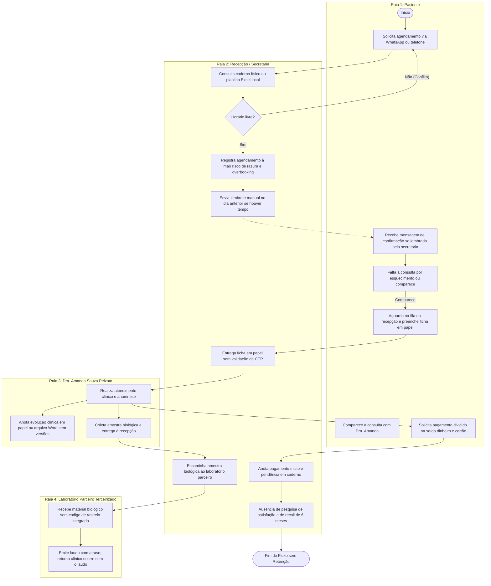

# Mapeamento do Processo Atual (AS-IS) — Consultório Amanda Souza Peixoto

> **Modelagem BPMN em Raias (Swimlanes)**  
> **Disciplina:** Engenharia de Requisitos — Professor Sérgio Haddad (CEUB)  
> **Equipe:** Davi Felinto, Isaac Soares, Miguel Dias, Lucas Evaldo, Vanessa Mendoça  
> **Cliente / Entrevistada:** Amanda Souza Peixoto  

---

## Diagrama BPMN (AS-IS)

---

## Gargalos Críticos do Processo AS-IS

1. **Overbooking e Choque de Horários:** Uso de caderno/planilha sem trava algorítmica.
2. **Absenteísmo Elevado (No-Show de 25% a 30%):** Falta de automação de lembretes preventivos 24h.
3. **Insegurança Jurídica e Risco LGPD:** Prontuário em papel/Word sem imutabilidade, versionamento ou trilha de auditoria.
4. **Descontrole de Pagamento Dividido:** Pagamento de entrada em PIX e saldo em cartão anotado em bloco de notas.
5. **Retorno Clínico Frustrado:** Paciente retorna sem que o laudo do laboratório parceiro tenha sido liberado.
6. **Perda de Recorrência (180+ dias):** Sem mecanismo de pós-consulta e recall de check-up semestral.
