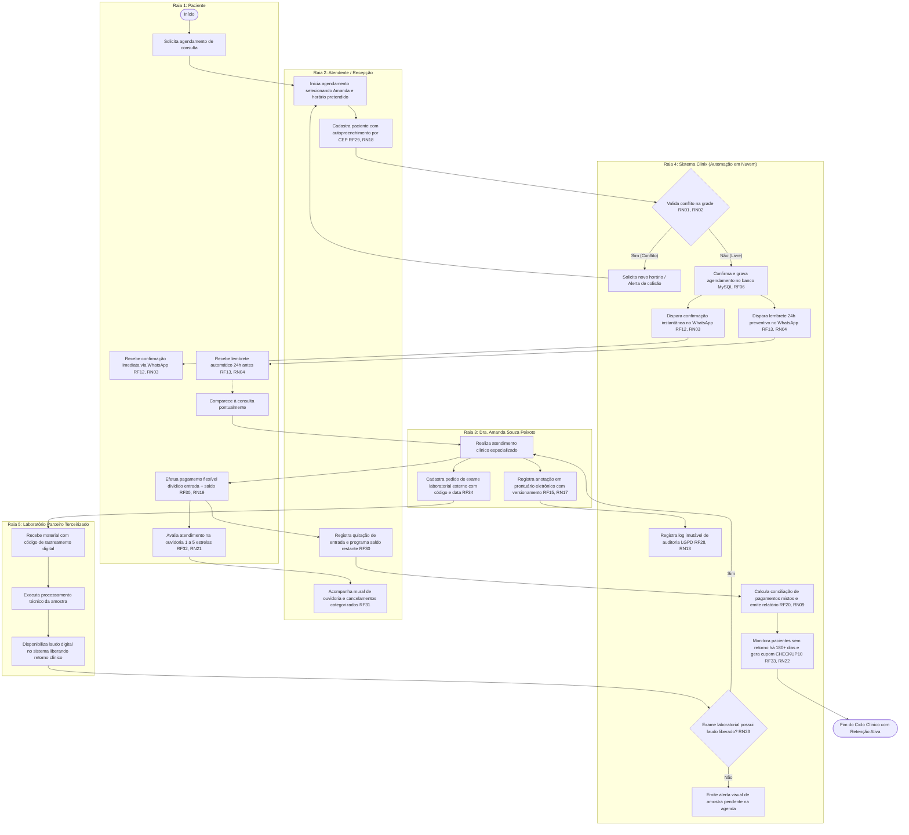

# Mapeamento do Processo Proposto (TO-BE) — Sistema Clinix

> **Modelagem BPMN em Raias (Swimlanes)**  
> **Disciplina:** Engenharia de Requisitos — Professor Sérgio Haddad (CEUB)  
> **Equipe:** Davi Felinto, Isaac Soares, Miguel Dias, Lucas Evaldo, Vanessa Mendoça  
> **Cliente / Entrevistada:** Amanda Souza Peixoto  

---

## Diagrama BPMN (TO-BE)

---

## Diferenciais da Solução TO-BE

1. **Validação Matemática Anti-Conflito (RN01, RN02):** Zero duplicidade de consultas.
2. **Engajamento Digital via WhatsApp (RF12, RF13, RN03, RN04):** Redução de até 80% do no-show.
3. **Agilidade Cadastral (RF29, RN18):** Autopreenchimento de logradouro, bairro, cidade e UF a partir do CEP.
4. **Segurança Jurídica e LGPD (RF15, RF16, RN17, RN13):** Histórico imutável de prontuários com trilha de auditoria.
5. **Flexibilidade Financeira (RF30, RN19):** Pagamento misto/dividido (Entrada + Saldo) com conciliação automática.
6. **Controle de Evasão (RF31, RN20):** Obrigatoriedade de categorizar cancelamentos para cálculo de métricas.
7. **Ouvidoria Transparente (RF32, RN21):** Notas de 1 a 5 estrelas e depoimentos anônimos.
8. **CRM Preventivo Semestral (RF33, RN22):** Recall ativo de pacientes ausentes há mais de 180 dias com cupom `CHECKUP10`.
9. **Sincronismo com Laboratórios Externos (RF34, RN23):** Amostras biológicas rastreadas com trava visual na agenda.
