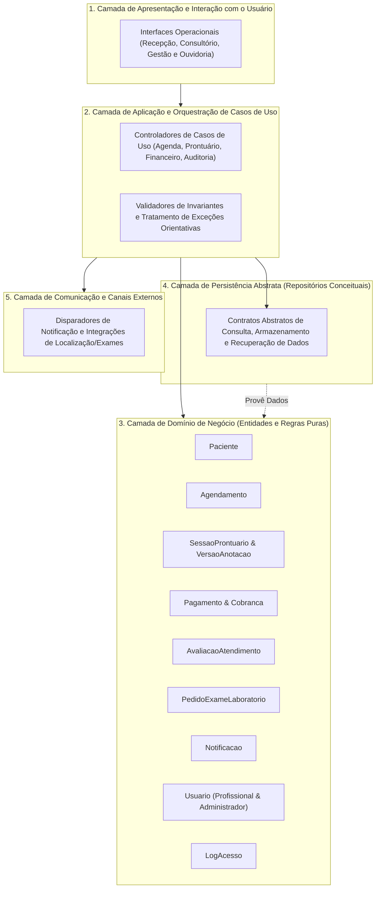
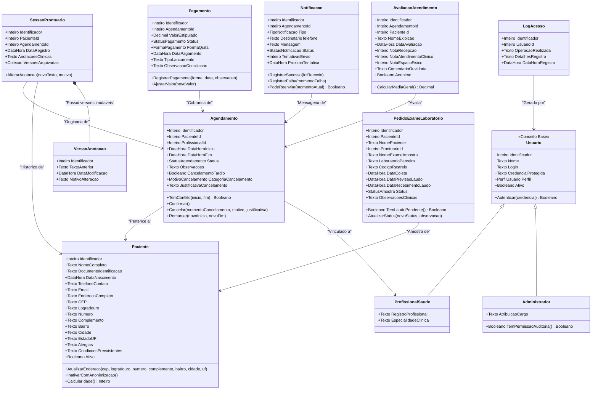
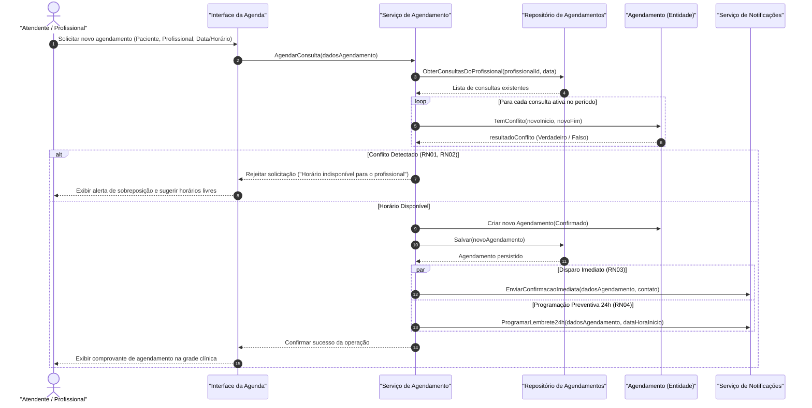
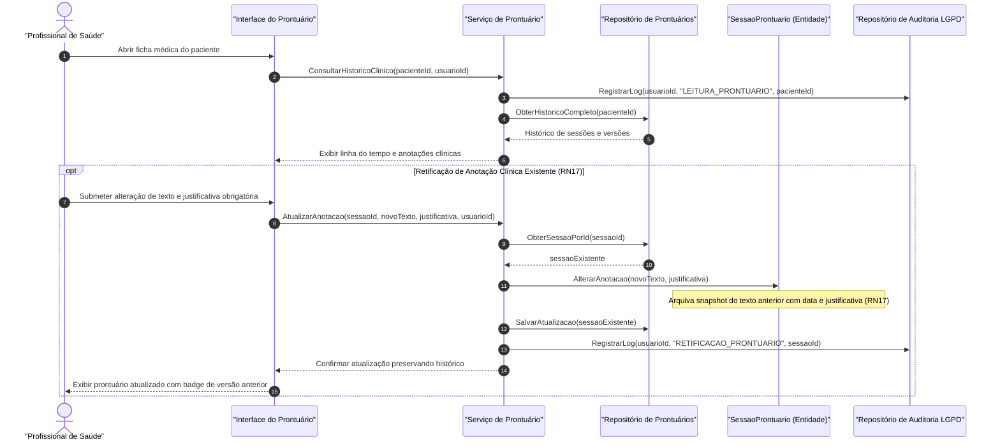
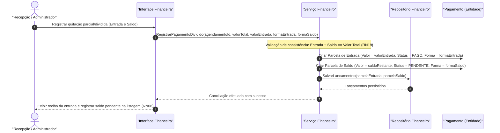
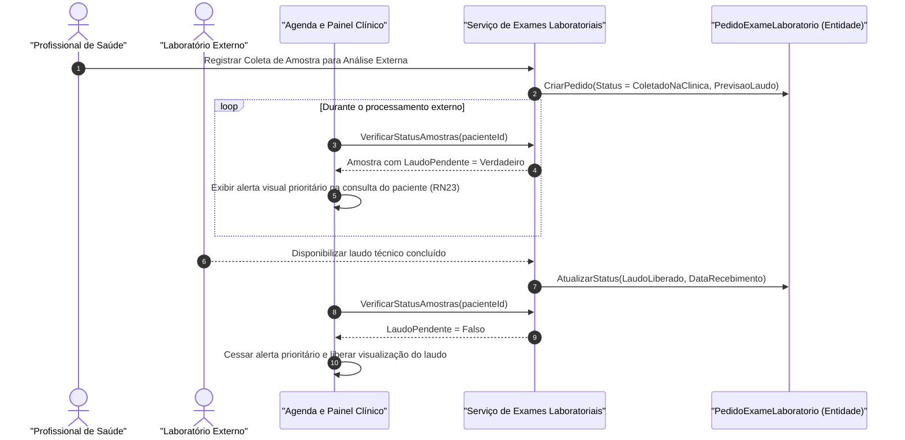
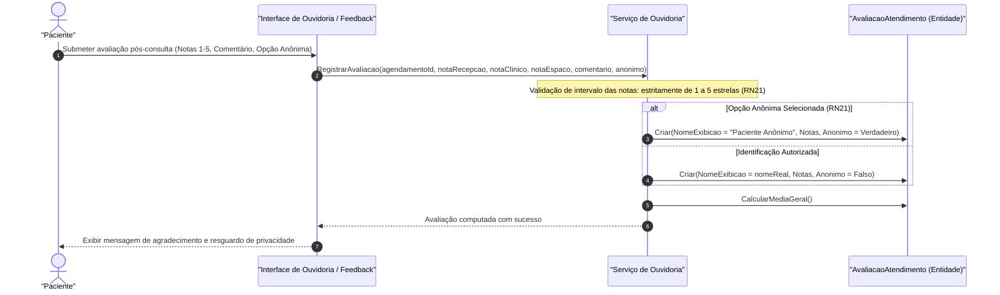
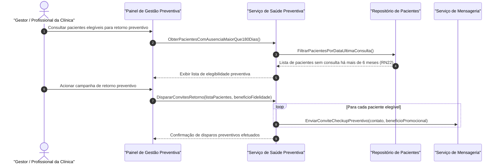

# Software Design Document (SDD)
## Sistema de Agendamento e Prontuário para Clínicas Pequenas (Clinix)

> **Documento de Design Conceitual de Software e Especificação de Domínio**  
> **Autor:** Davi Felinto — Engenharia de Software (CEUB)  
> **Referência de Requisitos:** [`docs/requisitos/README.md`](../requisitos/README.md) e [`Documento_Especificacao_Requisitos_Final.docx`](../requisitos/Documento_Especificacao_Requisitos_Final.docx)  
> **Escopo:** Arquitetura Conceitual, Entidades de Domínio, Regras de Negócio, Comportamentos do Sistema e Casos de Uso (100% Agnóstico de Tecnologias de Implementação)  
> **Data:** Outubro / 2026 — Versão Consolidada: 3.0 (34 Requisitos Funcionais, 23 Regras de Negócio e 16 Requisitos de Qualidade ISO/IEC 25010 e LGPD)

---

## 1. Introdução e Visão Geral

### 1.1 Propósito
Este **Software Design Document (SDD)** estabelece o design funcional, a modelagem conceitual de domínio, os fluxos operacionais e as regras de negócio que governam o **Sistema de Agendamento e Prontuário para Clínicas Pequenas (Clinix)**.

O objetivo primordial deste documento é traduzir as necessidades reais do ambiente de saúde em uma especificação de software lógica, elegante e desacoplada, garantindo a completa aderência aos requisitos funcionais (**RF01 a RF34**), às regras de negócio de domínio (**RN01 a RN23**) e aos requisitos de qualidade e governança (**RQ01 a RQ16**), em estrita conformidade com as diretrizes da norma internacional **ISO/IEC 25010** e com a **Lei Geral de Proteção de Dados (LGPD - Lei nº 13.709/2018)**.

### 1.2 Problema de Negócio e Solução Proposta
Consultórios e clínicas de pequeno porte (médicos, psicólogos, fisioterapeutas, fonoaudiólogos e nutricionistas) frequentemente enfrentam desafios críticos de gestão que afetam diretamente a qualidade do atendimento e a sustentabilidade financeira:
1. **Conflito de Horários:** Marcação acidental de consultas simultâneas para o mesmo profissional em agendas manuais ou planilhas despadronizadas.
2. **Absenteísmo e Evasão:** Faltas de pacientes ocasionadas pela ausência de mecanismos padronizados de confirmação imediata e lembretes preventivos com 24 horas de antecedência.
3. **Vulnerabilidade de Prontuários:** Anotações clínicas dispersas ou passíveis de rasura e exclusão indevida, sem trilha de auditoria e sem histórico imutável de retificações.
4. **Descontrole Financeiro:** Dificuldade no acompanhamento de consultas pendentes de quitação, impossibilidade de gerir pagamentos divididos (entrada e saldo) e ausência de relatórios mensais consolidados.
5. **Risco Regulatório (LGPD):** Falta de segregação de acesso entre o corpo clínico e a recepção, bem como inexistência de procedimentos de anonimização e registro de logs de acesso a dados sensíveis de saúde.
6. **Desconexão com Amostras Laboratoriais:** Insegurança no acompanhamento de exames terceirizados, gerando consultas realizadas sem o laudo do paciente.
7. **Inexistência de Gestão Preventiva e Ouvidoria:** Perda de vínculo com pacientes que não retornam há mais de 6 meses e ausência de canal formal de avaliação de satisfação.

A solução **Clinix** resolve essas lacunas por meio de uma arquitetura orientada a serviços conceituais bem delimitados, garantindo que as regras de saúde, finanças e segurança sejam executadas de forma automática e transparente pelo sistema.

---

## 2. Arquitetura Lógica e Conceitual do Sistema

O sistema é estruturado no padrão de **Separação de Conceitos (Separation of Concerns)**, organizado em 5 camadas lógicas funcionais:

### 2.1 Descrição das Camadas Conceituais

1. **Camada de Apresentação e Interação com o Usuário:** Responsável pela mediação entre os operadores (profissionais de saúde, recepcionistas e administradores) e o sistema. Assegura facilidade de uso em até 3 cliques a partir do painel principal (**RQ10**), com terminologia amigável e acessibilidade multiplataforma.
2. **Camada de Aplicação e Orquestração:** Centraliza a execução dos casos de uso, orquestrando entidades de negócio, persistência abstrata e canais de comunicação. Impede que a interface realize regras de negócio e garante que mensagens de validação sejam orientativas (**RQ11**).
3. **Camada de Domínio de Negócio:** O coração conceitual do software. Contém as entidades, atributos, comportamentos e invariantes clínicas e regulatórias. Suas regras são autônomas, independentes de interfaces de usuário ou mecanismos de armazenamento.
4. **Camada de Persistência Abstrata:** Define os contratos formais de recuperação e guarda permanente de entidades (isolando a lógica de negócio de qualquer formato físico de banco de dados).
5. **Camada de Comunicação e Canais Externos:** Abstrai serviços de envio de mensagens preventivas aos pacientes e integrações cadastrais.

---

## 3. Modelo Conceitual de Domínio (Entidades e Comportamentos)

A modelagem de entidades do domínio reflete a dinâmica clínica e administrativa, incorporando todos os atributos necessários para conformidade legal, financeira e de atendimento:

---

## 4. Diagramas de Sequência e Dinâmica de Comportamento do Sistema

Os diagramas a seguir representam o comportamento dinâmico e a orquestração de responsabilidades nos fluxos mais críticos do sistema.

### 4.1 Fluxo 1: Agendamento com Verificação de Conflito e Notificação Preventiva (RN01, RN02, RN03, RN04)

---

### 4.2 Fluxo 2: Atendimento Clínico e Prontuário com Versionamento Imutável e Auditoria LGPD (RN05, RN06, RN13, RN17, RQ07)

---

### 4.3 Fluxo 3: Gestão Financeira com Quitação Dividida em Entrada e Saldo (RN07, RN08, RN19)

---

### 4.4 Fluxo 4: Rastreamento de Amostras Laboratoriais e Alerta Clínico na Agenda (RN23)

---

### 4.5 Fluxo 5: Avaliação de Atendimento (Ouvidoria) e Opção de Anonimato (RN21)

---

### 4.6 Fluxo 6: Campanha de Recorrência Preventiva de Saúde (RN22)

---

## 5. Especificação Completa das 23 Regras de Negócio do Domínio (RN01 a RN23)

As regras a seguir definem os comportamentos invioláveis do sistema, formuladas de maneira estritamente conceitual e agnóstica de tecnologias de implementação:

| Código | Nome da Regra | Enunciado Conceitual e Comportamento do Sistema | Requisitos Vinculados |
| :--- | :--- | :--- | :--- |
| **RN01** | Verificação Prévia de Conflito | Ao receber solicitação de agendamento ou remarcação, o sistema deve verificar obrigatoriamente a disponibilidade de horário na agenda do profissional antes de qualquer confirmação. | RF06, RF09 |
| **RN02** | Bloqueio de Horário Indisponível | Havendo sobreposição de horário com outra consulta ativa ou com período bloqueado na agenda do profissional, o sistema deve recusar a operação e orientar a seleção de outro horário livre. | RF09, RF11 |
| **RN03** | Confirmação Imediata de Agendamento | A confirmação formal de uma consulta deve acionar imediatamente a emissão de notificação com os dados do agendamento para o canal de contato do paciente. | RF06, RF12 |
| **RN04** | Programação de Lembrete Preventivo de 24 Horas | Toda consulta agendada deve ter o envio de um lembrete preventivo programado automaticamente para exatamente 24 horas antes do início previsto do atendimento. | RF06, RF13 |
| **RN05** | Obrigatoriedade de Registro de Atendimento Clínico | O profissional de saúde deve registrar as notas clínicas da sessão antes de concluir e encerrar o atendimento do paciente no sistema. | RF15 |
| **RN06** | Atualização Imediata da Linha do Tempo Médica | Todo registro ou retificação de sessão de prontuário deve alimentar em tempo real o histórico médico cronológico do paciente. | RF15, RF17, RF23 |
| **RN07** | Unicidade de Cobrança por Consulta | Não é permitido gerar mais de uma cobrança financeira para o mesmo agendamento, ressalvado o desmembramento decorrente de quitação dividida em entrada e saldo. | RF19, RF20, RF30 |
| **RN08** | Manutenção de Cobranças em Aberto | Cobranças com status pendente devem permanecer na listagem de pendências financeiras até que seja formalizada a quitação com forma e data de liquidação. | RF20, RF21 |
| **RN09** | Conciliação e Fechamento Financeiro Mensal | O demonstrativo financeiro mensal deve consolidar estritamente os atendimentos, faturamentos, valores liquidados e saldos em aberto vinculados ao mês de referência. | RF22 |
| **RN10** | Sinalização de Cancelamento Tardio (< 24 Horas) | Cancelamentos solicitados com menos de 24 horas de antecedência do horário agendado devem ser gravados obrigatoriamente com sinalização de cancelamento tardio no histórico. | RF08, RF31 |
| **RN11** | Sigilo Clínico e Acesso Restrito | O acesso a prontuários eletrônicos, fichas cadastrais e informações clínicas de pacientes é estritamente restrito a usuários cadastrados e autenticados. | RF26 |
| **RN12** | Segregação de Funções e Perfis (RBAC) | Usuários com perfil Profissional acessam exclusivamente os pacientes, agendas e prontuários vinculados à sua atuação clínica; usuários com perfil Administrador acessam recepção, cadastros, financeiro e governança, sem acesso indevido ao sigilo clínico dos atendimentos. | RF27 |
| **RN13** | Trilha de Auditoria Imutável (LGPD) | Toda consulta, visualização ou edição realizada em dados de prontuário e registros pessoais de saúde deve registrar log de auditoria com identificação do usuário, data e hora. | RF28 |
| **RN14** | Tolerância a Falhas na Comunicação (Retentativa Única) | Em caso de falha no envio de notificação de confirmação ou lembrete, o sistema deve realizar automaticamente uma única nova tentativa após 15 minutos. | RF14 |
| **RN15** | Alerta Visual de Falha de Notificação | Persistindo o insucesso após a retentativa automática, o sistema deve emitir alerta visual na agenda do profissional e na recepção para possibilitar contato manual. | RF14 |
| **RN16** | Inativação Lógica e Anonimização LGPD | A exclusão de pacientes deve ser estritamente lógica (inativação cadastral), mantendo o histórico de prontuários e anonimizando dados cadastrais dispensáveis (telefone, e-mail, endereço). | RF03 |
| **RN17** | Imutabilidade e Versionamento de Prontuário | Anotações clínicas anteriores nunca são sobrescritas; qualquer edição gera uma nova versão com data e justificativa formal obrigatória, preservando o histórico anterior. | RF16 |
| **RN18** | Consistência Cadastral de Endereçamento e CEP | O cadastro de endereço do paciente deve conter um CEP válido composto por 8 dígitos numéricos, com preenchimento coerente de logradouro, bairro, cidade e estado. | RF29 |
| **RN19** | Conciliação Matemática de Pagamento Dividido | Na modalidade de pagamento misto ou dividido, a soma exata da Entrada com o Saldo restante deve corresponder ao valor total da consulta, mantendo o saldo em aberto até a liquidação. | RF30 |
| **RN20** | Obrigatoriedade de Motivo e Justificativa no Cancelamento | Todo cancelamento de consulta deve registrar obrigatoriamente a seleção de uma categoria padronizada (Desistência, Conflito, Financeiro, Saúde, Satisfação, Outro) e justificativa descritiva. | RF31 |
| **RN21** | Integridade de Notas e Anonimato na Ouvidoria | As notas atribuídas na avaliação de atendimento devem situar-se no intervalo de 1 a 5 estrelas para recepção, atendimento clínico e instalações, resguardando a opção de envio anônimo. | RF32 |
| **RN22** | Janela de Elegibilidade Preventiva (180+ Dias) | Pacientes sem atendimentos clínicos registrados há mais de 180 dias devem ser qualificados pelo sistema como elegíveis a ações preventivas de retorno à saúde com incentivo de fidelidade. | RF33 |
| **RN23** | Alerta Clínico de Amostra Laboratorial Pendente | Consultas com exames ou amostras biológicas encaminhadas a processamento externo devem manter sinalização de alta prioridade na agenda clínica até a disponibilização do laudo. | RF34 |

---

## 6. Matriz de Rastreabilidade Conceitual (Requisitos → Domínio)

A matriz abaixo comprova como cada Requisito Funcional (**RF01 a RF34**) é suportado pelas entidades de domínio e pelos comportamentos do sistema:

| Requisito Funcional | Denominação do Requisito | Entidade Conceitual Responsável | Comportamento do Sistema | Regras Associadas |
| :--- | :--- | :--- | :--- | :--- |
| **RF01** | Inclusão de Paciente | `Paciente` | Validação de dados obrigatórios e criação de ficha | RN11, RN18 |
| **RF02** | Alteração de Paciente | `Paciente` | Atualização cadastral com consistência de dados | RN11, RN18 |
| **RF03** | Inativação Lógica com Anonimização | `Paciente` | `InativarComAnonimizacao()` mantendo histórico clínico | RN16 |
| **RF04** | Consulta de Ficha Cadastral | `Paciente` | Exibição de ficha com destaque de alertas clínicos | RN11, RN12 |
| **RF05** | Busca de Pacientes | `Paciente` | Localização imediata por nome ou número de documento | RN11, RN12 |
| **RF06** | Agendamento de Consultas | `Agendamento` | Criação de agendamento após validação de agenda | RN01, RN02, RN03, RN04 |
| **RF07** | Remarcação de Consultas | `Agendamento` | `Remarcar()` validando disponibilidade do novo horário | RN01, RN02 |
| **RF08** | Cancelamento de Consultas | `Agendamento` | `Cancelar()` com verificação de antecedência tardia (<24h) | RN10, RN20 |
| **RF09** | Verificação de Conflitos | `Agendamento` | `TemConflito()` impedindo sobreposição de horários | RN01, RN02 |
| **RF10** | Visualização da Agenda Clínica | `Agendamento` | Exibição em grade diária, semanal e mensal | RN01, RN02, RN23 |
| **RF11** | Bloqueio de Períodos da Agenda | `Agendamento` | Criação de intervalos de indisponibilidade profissional | RN02 |
| **RF12** | Confirmação Imediata de Consulta | `Notificacao` | Disparo instantâneo com detalhes do agendamento | RN03 |
| **RF13** | Lembrete Preventivo de 24 Horas | `Notificacao` | Programação e envio de lembrete preventivo antecipado | RN04 |
| **RF14** | Tolerância a Falhas em Notificações | `Notificacao` | `RegistrarFalha()` e retentativa única após 15 minutos | RN14, RN15 |
| **RF15** | Registro de Sessão Clínica | `SessaoProntuario` | Criação de anotação clínica vinculada ao atendimento | RN05, RN06, RN13 |
| **RF16** | Retificação com Versionamento | `SessaoProntuario` | `AlterarAnotacao()` criando snapshot imutável | RN17 |
| **RF17** | Consulta à Linha do Tempo Médica | `SessaoProntuario` | Exibição cronológica completa de atendimentos e versões | RN06, RN11, RN13 |
| **RF18** | Registro de Alergias e Condições | `Paciente` | Destaque prioritário de condições clínicas preexistentes | RN06, RN15 |
| **RF19** | Registro de Cobrança de Consulta | `Pagamento` | Geração de cobrança sem duplicidade por agendamento | RN07 |
| **RF20** | Quitação e Liquidação Financeira | `Pagamento` | `RegistrarPagamento()` com forma, data e conciliação | RN07, RN08 |
| **RF21** | Consulta de Pendências Financeiras | `Pagamento` | Filtragem de cobranças pendentes por período e paciente | RN08 |
| **RF22** | Resumo Financeiro Mensal | `Pagamento` | Consolidação matemática de faturamento e quitações | RN09 |
| **RF23** | Histórico Geral de Atendimentos | `Agendamento`, `SessaoProntuario` | Rastreabilidade completa de consultas realizadas e faltas | RN06, RN10 |
| **RF24** | Relatório Gerencial Consolidado | `Agendamento`, `Pagamento` | Apuração analítica de atendimentos, valores e motivos | RN09, RN20 |
| **RF25** | Exportação Padronizada com Auditoria | `LogAcesso` | Exportação de dados e prontuário com registro formal | RN13 |
| **RF26** | Autenticação Segura | `Usuario` | Validação de credenciais protegidas e controle de sessão | RN11 |
| **RF27** | Controle de Acesso Baseado em Papéis | `Usuario` | Segregação estrita entre Profissional e Administrador | RN12 |
| **RF28** | Registro de Trilha de Auditoria | `LogAcesso` | Gravação imutável de operações sobre dados sensíveis | RN13 |
| **RF29** | Endereço Estruturado com CEP | `Paciente` | `AtualizarEndereco()` estruturado com campos atômicos | RN18 |
| **RF30** | Pagamento Dividido Entrada + Saldo | `Pagamento` | Desdobramento de quitação com validação de soma total | RN19 |
| **RF31** | Motivos e Métricas de Cancelamento | `Agendamento` | Registro de categoria de motivo e justificativa | RN10, RN20 |
| **RF32** | Ouvidoria e Avaliação de Atendimento | `AvaliacaoAtendimento` | Coleta de notas (1-5), cálculo de média e anonimato | RN21 |
| **RF33** | Gestão de Recorrência Preventiva | `Paciente`, `Agendamento` | Identificação de ausência de 180+ dias e incentivo | RN22 |
| **RF34** | Rastreamento de Amostras Laboratoriais | `PedidoExameLaboratorio` | Gestão de ciclo de vida de amostras e alerta na agenda | RN23 |

---

## 7. Requisitos de Qualidade e Governança (ISO/IEC 25010 & LGPD)

A especificação de qualidade assegura que o sistema não apenas cumpra suas funções, mas atue com confiabilidade, segurança e excelência de experiência:

### 7.1 Segurança e Conformidade com a LGPD (Lei 13.709/2018)
- **Base Legal e Finalidade Estrita (RQ01, RQ05):** Tratamento restrito à tutela da saúde e prestação de serviços clínicos.
- **Portabilidade de Dados (RQ02):** Capacidade de emissão e exportação estruturada do histórico clínico a pedido do titular.
- **Anonimização Segura (RQ03, RN16):** Preservação legal do histórico clínico com remoção de contatos identificadores ao inativar paciente.
- **Criptografia e Proteção de Dados (RQ04, RQ08):** Proteção integral de dados em repouso e em trânsito; credenciais protegidas por algoritmo irreversível de derivação com salt.
- **Controle de Acesso Baseado em Papéis - RBAC (RQ06, RN12):** Segregação formal de atribuições entre corpo clínico e recepção/administração.
- **Não Repúdio e Trilha de Auditoria (RQ07, RN13):** Registro imutável de autor, data, hora e operação realizada sobre prontuários e dados cadastrais.

### 7.2 Usabilidade e Acessibilidade Operacional
- **Facilidade de Aprendizado (RQ09):** Interfaces claras, intuitivas e desenhadas para profissionais de saúde e recepcionistas.
- **Regra de Eficiência em 3 Cliques (RQ10):** Acesso às operações vitais (agendar consulta, abrir prontuário, registrar quitação) em no máximo 3 cliques a partir do painel principal.
- **Mensagens Orientativas e Não Técnicas (RQ11):** Tratamento de impedimentos de negócio com instruções claras de resolução, sem exposição de jargões técnicos ao usuário final.

### 7.3 Confiabilidade, Resiliência e Disponibilidade
- **Integridade Transacional (RQ12):** Impossibilidade de corrupção ou sobreposição de horários e prontuários.
- **Alta Disponibilidade em Horário Comercial (RQ13):** Índice mínimo de 99% de disponibilidade durante o funcionamento da clínica.
- **Tolerância a Falhas na Comunicação (RQ14, RN14, RN15):** Mecanismos de retentativa automática de mensageria e transição para alerta visual manual.

### 7.4 Adequação Funcional e Governança Financeira
- **Completude de Escopo (RQ15):** Cobertura integral das 13 macrofuncionalidades especificadas.
- **Exatidão e Auditoria Contábil (RQ16):** Rastreabilidade e consistência matemática em fechamentos mensais e conciliações de pagamento dividido, com guarda documental para fins fiscais.

---

## 8. Conclusão e Síntese do Design

O **Software Design Document (SDD)** aqui consolidado representa um modelo conceitual maduro, robusto e perene para o **Clinix**:

1. **Separação Completa entre Negócio e Tecnologia:** Todas as regras de saúde, cancelamento, quitação e auditoria residem no domínio conceitual, garantindo que a solução permaneça estável independentemente de futuras evoluções de linguagens, bancos de dados ou frameworks.
2. **Integralidade do Domínio Clínico:** Todas as 6 demandas emergentes levantadas em homologação com clientes reais foram incorporadas com rigor formal:
   - Endereçamento estruturado com validação de CEP (**RF29, RN18**);
   - Pagamento misto/dividido em entrada e saldo com conciliação (**RF30, RN19**);
   - Governança de cancelamento tardio com motivo e justificativa (**RF31, RN20**);
   - Ouvidoria com avaliação multidimensional e anonimato (**RF32, RN21**);
   - Prevenção à evasão com retorno semestral de 180+ dias (**RF33, RN22**);
   - Gestão de amostras laboratoriais terceirizadas com alerta clínico na agenda (**RF34, RN23**).
3. **Harmonia Acadêmica e Prática:** O design reflete o equilíbrio entre o rigor metodológico de Engenharia de Software (norma ISO/IEC 25010 e LGPD) e a praticidade exigida no cotidiano de uma clínica de pequeno porte.
